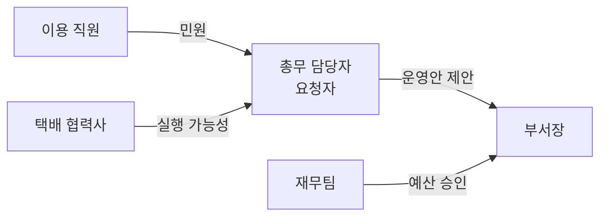

# FDE 디스커버리

FDE는 분석하고 권고하는 데서 멈추지 않고, 고객 현장의 문제를 정의해서 실제로 돌아가게 만드는 사람이다.
디스커버리는 리서치가 아니라 엔지니어링 작업이다. 여기서 만든 산출물(관계도, 온톨로지, 합의문)이 그대로 데이터 모델, 지표, 화면이 된다.

## 원칙
1. **사람부터 그린다 (토폴로지 스캔).** 시킨 사람, 책임지는 사람, 실제로 쓰는 사람이 모두 고객이다. 누구에게 어떻게 칭찬받을지, 누가 어떤 데이터를 알고 있는지부터 파악한다. 담당자 한 명의 요구가 조직의 요구가 아니다.
2. **"완료"를 먼저 정의한다.** 해결책을 말하기 전에 사용자와 성공 기준(숫자)을 확인한다. 해결책 단어("최적화", "AI", "자동화")는 처음에 꺼내지 않는다.
3. **간극 하나를 깊게 판다.** README에 문제와 해법이 다 적혀 있어도, 그 안에서 문서만으로 결정할 수 없는 핵심 판단 하나를 찾는다. 다른 참가자와의 차이는 여기서 난다.
4. **가장 작은 가치 단위부터 보여준다.** 완벽한 시스템이 아니라 사용자가 한 번에 끝까지 쓸 수 있는 흐름 하나. 말로 설명하지 말고 눈에 보이는 것을 빨리 보여주고 "빨간 펜"을 받는다.
5. **범위를 자르고 방어한다.** 안 만들 것을 명시하고, 왜 잘랐는지 근거를 남긴다. 반론을 받으면 고집하지 말고 수정한다.
6. **난제에 집중한다.** 담당자가 AI 한 번 돌려서 바로 할 수 있는 부분은 빨리 끝내고, 판단과 맥락이 필요한 부분(암묵지, 이해관계 충돌)에 시간을 쓴다.
7. **버려질 준비를 한다.** 결과물은 우리가 떠난 뒤 담당자가 기준과 데이터를 바꿔 다시 쓸 수 있어야 한다. 메인테이너와 갱신 방법을 남긴다.

## 1. 토폴로지 스캔 (`docs/work/STAKEHOLDERS.md`)
조직도가 아니라 "이 프로젝트에서 누가 키맨이고 누구를 어떻게 만족시켜야 하나"의 지도다. 우리를 가운데 두고 만나는 사람을 통해 점점 넓혀 간다. 맵은 대화할 때마다 갱신한다.

**그리는 순서**
1. 직접 소통하는 사람 (과제의 담당자)
2. 한 다리 건너 소통하는 사람 (담당자의 상사, 재무, 현장, 협력사, 이용자)
3. 각자의 역할과 니즈, 그리고 무엇을 아는지/어떤 데이터에 접근하는지 (사람이 곧 DB이자 인터페이스)
4. 키맨 레이어: 시킨 사람, 책임지는 사람, 쓰는 사람, 조직도에 없지만 실제로 결정하는 사람

**계속 던지는 질문**
- 이 일이 성공하면 키맨들에게 **어떻게 칭찬받는가**? (각자에게 무엇이 성공인가)
- 실패하면 누가 가장 큰 리스크를 지는가?
- 필요한 데이터가 없을 때 누구에게 가야 하는가?
- 조직도에 없지만 강한 결정권을 가진 사람이 있는가?
- 우리가 떠난 뒤 이걸 누가 유지하는가?
- **왜 우리를 불렀나?** 일손 부족, 경험 없음, 부서 간 이해관계, 무엇부터 할지 불분명 중 무엇인가. 그 빈 곳이 우리의 범위다.

과제 문서와 담당자 첫 대화에서 등장한 사람과 부서를 전부 뽑아 표와 그림으로 남긴다. 모르는 칸은 "?"로 두고 질문 목록으로 보낸다.
- 빈칸을 물으면 답하기 막막하다. 추측으로 채운 초안을 보여 주고 "틀린 곳을 고쳐 주세요"라고 묻는다.
- 사람이나 권력("누가 실세인가")을 직접 묻지 않는다. 일과 결과물로 묻는다: 시킨 사람은 "이 결과를 누구에게 보고하시나요?", 결정권은 "실제로 바뀌려면 어디서 OK가 나나요?", 쓰는 사람은 "틀리면 누가 제일 먼저 연락하나요?", 숨은 결정권은 "전에 비슷한 시도가 어디서 멈췄나요?"

| 이해관계자 | 레이어 | 고객 유형 | 칭찬받는 조건(성공) | 우려 | 아는 것/가진 데이터 | 결정권 |
|---|---|---|---|---|---|---|
| 담당자 (총무팀) | 직접 | 책임지는 사람, 운영 | 민원 감소, 근거 있는 재배치안 | 업무 증가, 설명 못 하는 안 | 민원 이력, 기존 배치 사정 | 운영안 제안 |
| 부서장 | 한 다리 | 시킨 사람 | 비용 내 개선, 보고 가능한 숫자 | 반발, 예산 초과 | 예산 방침 | 승인 |
| 재무팀 | 한 다리 | 숨은 결정권 | 보관함 수 유지 또는 축소 | 증설 | 임대 단가 | 예산 승인 |
| 이용 직원 | 한 다리 | 쓰는 사람 | 가까운 보관함, 빈 칸 | 보관함 철거 | 실제 이용 패턴 | 없음(집단 민원은 큼) |
| 택배 협력사 | 한 다리 | 실행자 | 하루 안에 도는 배송 동선 | 거점 변경 부담 | 동선, 소요 시간 | 실행 가능성 |
| 메인테이너 후보 | ? | 우리가 떠난 뒤 | 스스로 기준을 바꿔 다시 돌릴 수 있음 | 블랙박스 | ? | 운영 |


- 관계도에서 **충돌선**(관심사가 반대인 쌍)을 찾는다. 그게 시나리오 비교의 축이 된다. 예: 이용자 편의 vs 재무 비용.
- **결정권자**가 누구인지 확인한다. 결과물 화면은 결정권자가 3초 안에 판단할 수 있게 만든다.
- 과제 환경에서 대화할 수 있는 상대가 담당자 한 명뿐이어도, 담당자에게 "재무팀은 이걸 어떻게 볼까요?", "이 안을 누가 최종 승인하나요?", "개편 후 기준이 바뀌면 누가 다시 돌리나요?"처럼 대리 질문한다.

## 2. 도메인 온톨로지 (`docs/work/ONTOLOGY.md`)
고객의 **명사(엔티티), 속성, 동사(관계와 이벤트)**를 먼저 모델링한다. 일반 모델은 일반 답을 낸다. 가치는 고객의 명사와 동사에 맞춘 데이터 모델에서 나온다.
```
엔티티: 직원(id, 근무 건물, 층, 근무형태) / 건물(id, 좌표)
        보관함(id, 위치, 칸 수, 기존 여부) / 배송 동선(id, 보관함 순서)
관계:   직원 -찾아간다-> 보관함 / 동선 -들른다-> 보관함
이벤트: 택배 도착(직원, 일자, 크기) / 수령(직원, 일자, 시각)
파생값: 직원별 최근접 보관함 도보 시간, 보관함별 일 수요, 칸 부족 일수
```
- 데이터 파일의 컬럼을 이 모델에 매핑하고, 매핑 안 되는 것과 없는 것을 질문으로 만든다.
- 이 파일이 `core`의 모델 클래스와 Python DataFrame 컬럼의 기준이 된다.

## 3. 현재 업무 흐름 (as-is)
담당자가 지금 이 일을 어떻게 하는지 단계로 적는다. 각 단계의 입력, 출력, 소요 시간, 누가, 어디서 막히는지.
```
1. 분기 1회 민원과 수령 기록을 엑셀로 모음 (1주)
2. 담당자가 도면 보며 보관함 위치 수기 조정 (3일) → 근거 설명 어려움 ← 간극
3. 협력사에 위치 전달 → 협력사가 배송 동선 가능 여부 회신 (1주)
4. 민원 접수 시 개별 대응
```
막히는 지점이 결과물이 들어갈 자리다. Before/After를 이 흐름 위에 그릴 수 있어야 한다.

## 4. 암묵지 끌어내기
현업은 너무 당연한 것을 설명하지 않는다. 문서와 데이터에 없는 기준(예외 처리, 관행, 보고 취향)이 결과물의 품질을 가른다.
- 담당자 발언은 **화자, 상황, 출처**를 붙여 기록한다 ("담당자, 야간 근무자 얘기 중: 야간조는 경비실 수령이 관행").
- 같은 단어도 부서마다 뜻이 다를 수 있다("이용률", "매출"). 정의를 확인한다.
- 문서 기준과 담당자 말, 또는 두 사람의 기준이 다르면 충돌로 기록하고 1) 사실 오류인지 2) 상황이 다른지(언제 어느 쪽이 적용되나) 3) 그래도 다르면 "원래 이 회사에서는 어떻게 하셨어요?"를 묻는다.
- 질문 예: "예외로 처리하는 경우가 있나요?", "작년에 이걸 바꿨을 때 어떤 반응이 있었나요?", "보고드릴 때 꼭 들어가야 하는 숫자가 있나요?"

## 5. 문제 분해
1. 사용자는 누구이고 몇 명인가, 기술에 익숙한가
2. 이 결과물로 **어떤 결정**을 내리는가 (결정이 없으면 화면이 아니라 보고서다)
3. 결정이 늦거나 틀리면 무엇이 비싸지나 (민원, 비용, 안전)
4. 그 결정에 필요한 숫자는 무엇인가 → 지표
5. 그 숫자를 만들려면 어떤 데이터와 계산이 필요한가 → 모델
6. 이번 범위에서 가장 작은 가치 단위는 무엇인가 → v0

## 6. 인터뷰
**순서**: 최근 곤란했던 사례 → 지금 임시방편 → 빈도와 소요 시간(정량화) → 결과물 사용자와 시점 → 범위 경계 → 운영 상황(관리자 수, 데이터 갱신 주기, 장애 시 영향, 개인정보) → 다른 이해관계자의 시각.

**규칙**
- 영향이 큰 질문 3~5개만 묶어 한 번에 보낸다(첫 메시지 형식은 `$fde-pilot` P1). 나머지는 가정으로 진행하고 기록한다.
- 질문마다 맥락 한 줄, 선택지와 결과, 기본 제안을 붙인다. 선택지 질문은 `$decision-cards` 형식으로.
- 데이터 의문은 근거를 붙인다: "주소 결측이 37건(4%)인데 제외할까요?"
- 모호한 발언은 측정 가능한 형태로 바꿔 되묻는다.

| 발언 | 바꾼 형태 | 되묻기 |
|---|---|---|
| "15분 넘으면 안 탈 것 같다" | soft 제약: 도보 15분 초과 인원 비율 | "15분 초과가 몇 % 이하면 괜찮을까요?" |
| "민원이 적으면 좋겠다" | 지표: 기존보다 불리해지는 인원 수 | "기존보다 멀어지는 사람이 몇 명까지 괜찮나요?" |
| "효율적으로" | 지표: 차량 수, 총 운행 시간 | "효율은 비용 기준인가요, 시간 기준인가요?" |

- 대화 전문을 에이전트에 붙여넣지 말고 요지만 `QUESTIONS.md`에 남겨 전달한다.
- **말이 바뀌면 진짜 목표를 본다.** 요구가 바뀌는 건 담당자도 목표를 향해 가며 확신이 없어서다. "왜 또 바꾸지"가 아니라 그 목표에 비추어 우리가 먼저 다음 안을 제안한다.
- 담당자에게 보내는 메시지는 AI 초안을 그대로 보내지 않는다. 두괄식, 짧게, 내 판단을 담아서 (`$decision-cards` 3절).

## 7. 서면 합의 (`docs/work/AGREEMENT.md`)
구현 전에 담당자에게 "이렇게 이해했는데 맞나요?"로 확인받는다: 문제와 원인, 성공 기준(지표, 현재값, 목표값, 측정 방법), 만들 것, 안 만들 것, 제약. 확인 문구를 그대로 기록하고 커밋한다.

## 8. 빠른 가시화
합의 직후 30분 안에 **동작하는 v0 화면**을 담당자에게 보여주고 피드백을 받는다. 예외 규칙과 승인 조건은 말이 아니라 화면을 보면서 정한다. 보여줄 때는 Before(기존안 지표)와 After(새 안 지표)를 나란히 둔다.

## 9. 종으로 연결하기
실무 결과(시간표)만 만들면 결정권자는 효능감을 못 느낀다. 같은 흐름에서 **실무 결과 → 보고용 요약 → 의사결정 지원**까지 이어지게 만든다. 화면 상단의 결론과 비교표가 보고 단계, 시나리오 선택이 의사결정 단계다.

## 10. 인계 (버려질 준비)
`RESULT.md`에 "운영 인계" 절을 쓴다: 메인테이너(누가), 기준을 바꾸는 법(파라미터, 설정 파일), 데이터를 갈아 끼우는 법, 다시 계산하고 검증하는 명령, 알려진 한계.

참고: `references/sources.md` (방법론 출처), `references/kkachilhan-notes.md` (스페이스와이 황현태 대표 '까칠한AI' 본편 19개 영상 노트)
