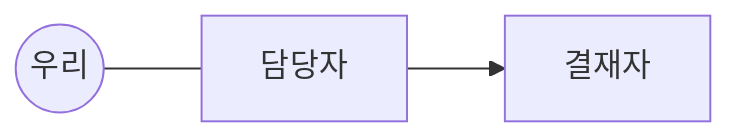

# 토폴로지 스캔

| 이해관계자 | 레이어(직접/한 다리) | 고객 유형(시킨/책임/쓰는/숨은 결정권/메인테이너) | 칭찬받는 조건 | 우려 | 아는 것/가진 데이터 | 결정권 |
|---|---|---|---|---|---|---|
|  |  |  |  |  |  |  |

## 키맨별 성공 조건 (누구에게 어떻게 칭찬받나)
-

## 충돌선 (관심사가 반대인 쌍)
-

## 왜 우리를 불렀나 (빈 곳)
-

## 실패하면 누가 리스크를 지나
-

## 데이터가 없을 때 누구에게 가나
-

## 우리가 떠난 뒤 메인테이너
-

## 확인 필요 (?)
-
